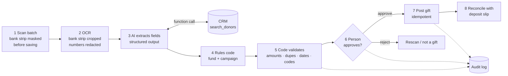

# GiftFlow: AI-assisted intake for donation checks and gift-in-kind forms

**[▶ Live demo](https://giftflow-demo.streamlit.app/)** · runs in offline demo mode on synthetic data. Click **Run intake**, then open **Review**. (If it's been idle, it takes about 30 seconds to wake up.)

GiftFlow reads scanned donation checks and in-kind donation forms, extracts the data with OCR and an LLM, suggests the donor match and fund/campaign coding, **checks the AI's work in code**, and puts every gift in front of a **person for approval** before anything is posted. Posted gifts reconcile against the bank deposit slip, and every step is written to an audit log.

> All names, addresses, banks and account numbers in this repo are **synthetic**. The sample batch includes deliberate problems so the demo shows every safety check.


## Why it exists

Manually reading each check, matching the donor, choosing the fund and campaign, and typing it into the CRM takes hours a week, and every keystroke is a chance for an error. GiftFlow lets the AI do the reading and suggesting, and lets people make the decisions.

## How it works



| Part | Job | File |
| --- | --- | --- |
| Saving uploads | Paints over the bank strip (MICR line) **before** the file is written, so the unmasked original never reaches disk. The masked image is OCR'd first; if any 8+ digit run is still readable, or Tesseract isn't available to check, the upload is refused and nothing is saved | `giftflow/ocr.py` |
| OCR | Image → text with word-level confidence. Crops the bank strip before reading, then redacts any 8+ digit number in the text and the low-confidence word list | `giftflow/ocr.py` |
| AI extraction | LLM returns a **strict JSON schema** (structured output). It can **call `search_donors`** (function calling) to look up the CRM; our code runs the lookup. Retries 429/5xx with exponential backoff. Document text is fenced as data, not instructions, and any `<<<`/`>>>` inside it is neutralised so it can't close the fence | `giftflow/llm.py` |
| Offline mode | Deterministic mock extractor with the same interface and the same function call, so the app runs with no API key or internet | `giftflow/llm.py` |
| Donor matching | Fuzzy name + address scoring with nickname handling (Bob → Robert). Never creates donors automatically | `giftflow/matching.py` |
| Coding | Keyword rules first (predictable, free, auditable). AI suggestion only when no rule applies, and only from the allowed list | `giftflow/coding.py` |
| Validation | Required fields, amount box vs written amount, AI amount vs the OCR text, more than one amount on a check, OCR low-confidence digits, future/stale dates, AI donor pick vs its own search results, donor exists, donor certainty, valid codes, AI-chosen coding, GIK value, duplicates | `giftflow/validate.py` |
| Review | Re-validates the reviewer's version with the stored OCR text and AI tool calls; blocking issues prevent approval; records every correction and every [confirmation](#reviewer-confirmations) | `giftflow/review.py` |
| Posting | One transaction per gift; unique constraints make re-running safe and stop the same check posting twice | `giftflow/posting.py` |
| Reconciliation | Posted + approved check totals must equal the deposit slip | `giftflow/posting.py` |
| App | Streamlit: intake, review queue, post & reconcile, accuracy, audit log | `app.py` |

## Run it

```bash
# 1. Install Tesseract OCR. Without it the sample batch still runs (from the .txt OCR
#    files next to each sample), but uploaded scans are refused: they can't be checked for bank numbers.
brew install tesseract          # macOS
# sudo apt install tesseract-ocr                 (Ubuntu)
# winget install UB-Mannheim.TesseractOCR        (Windows; then add C:\Program Files\Tesseract-OCR to PATH)

# 2. Install Python packages
python -m venv .venv && source .venv/bin/activate
pip install -r requirements.txt

# 3. Run the app (offline mock AI by default)
streamlit run app.py
```

Click **Run intake** with "Use the sample batch" on, then open **Review**.

**Or run it with Docker** (includes Tesseract OCR):

```bash
docker build -t giftflow .
docker run --rm -p 8501:8501 giftflow                     # offline mock AI
docker run --rm -p 8501:8501 --env-file .env giftflow     # real OpenAI, see below
```

Open http://localhost:8501. Add `-v giftflow-data:/data` to keep the database between runs.

**Use the real OpenAI model:** copy `.env.example` to `.env`, set `LLM_PROVIDER=openai` and `OPENAI_API_KEY=...`. The key is read from the environment and never stored in code.

Other commands:

```bash
python scripts/generate_samples.py samples   # regenerate the synthetic batch
python scripts/run_batch.py samples 6625     # process a folder from the terminal
pytest -q                                    # 78 tests, no API key needed; the 27 real-OCR tests skip without Tesseract
```

## The 5-minute demo

1. **Intake:** run the sample batch (10 documents, deposit slip $6,625.00).
2. **Review:** flagged items are first.
   - `05` Angela Davis-Reed: amount box says **$175.00**, written amount says **$150.00** → blocked. The written amount is the legal amount, so correct it to 150 and approve.
   - `06` Robert Smith: the same check scanned twice → blocked as a duplicate → reject it.
   - `07` Kevin O'Brien: no matching donor → a person creates the donor (it is selected automatically), then approves.
   - `08` "R. Smith": two similar donors; the **address** points to Robert Smithson → pick him and approve.
   - `02` "Bob Martinez" matched to **Robert** Martinez through nickname handling. The memo is blank, so the fund/campaign is the AI's pick → tick "I've checked the fund and campaign" to approve.
   - `09` In-kind coats with no stated value → warning; the AI never assigns a value.
3. **Post & reconcile:** post 9 gifts → posted checks = **$6,625.00** = deposit slip → **balanced**. Download the gift import CSV.
4. **Accuracy:** the share of AI proposals accepted unchanged, and which fields reviewers corrected most.
5. **Audit log:** every AI step, approval, reviewer confirmation, donor creation and posting, with who and when.

The sample images are synthetic and shown as generated, bank line included. Uploaded scans are masked before they're saved.


## Common errors and how GiftFlow handles them

| Error | Caught by | Resolution |
| --- | --- | --- |
| Handwritten amount misread | Low-confidence digits from OCR; amount box ≠ written amount; batch total ≠ deposit | Flag for review; written amount governs; rescan if unreadable |
| Wrong donor | Match score below threshold; two similar donors | Name + address scoring; person picks; never auto-create |
| Same check twice | Same donor + check number + amount in an earlier scan or already posted | Blocked at review; unique index in the database as the last line of defence |
| AI invents or mangles a field | Strict schema + code validation + allowed code lists | Prompt says "null if unsure"; invalid values block approval |
| API rate limit / outage | 429 / 5xx / timeout | Exponential backoff with jitter; if it still fails, the document goes to review with the fields blank |
| Posting fails halfway | Per-gift transactions | Re-run posting: only missing gifts post (idempotent) |
| Gift-in-kind with no value | Empty value field | Warning; staff record the value |
| Bank numbers exposed | Masked in uploaded images before saving; cropped before OCR and redacted after (OCR text and low-confidence word list) | Upload refused if the masked image still shows an 8+ digit run; `tests/test_safety.py` checks every model request, DB row, audit entry and saved image |
| Prompt injection in a document | Document text is fenced; fence markers inside it are neutralised | The AI's output is checked against things it can't change: the OCR text, its own donor search results, the donor table, rule coding. Mismatches block until a person fixes or [confirms](#reviewer-confirmations) them; `tests/test_safety.py` feeds in hostile model answers |

## Reviewer confirmations

Some checks block approval of what the AI proposed until the reviewer either changes the field or ticks a confirmation on the review form. A confirmation turns the block into a warning and writes an audit entry with the reviewer's name. Ticking a box when it isn't needed logs nothing.

| Blocks when | Flag | Cleared by | Audit action (details) |
| --- | --- | --- | --- |
| The AI's donor wasn't returned by its own `search_donors` calls | `donor_not_searched` | Picking another donor, or "I've verified this donor" | `donor_confirmed_unsearched` (donor ID) |
| The AI's amount doesn't appear as a dollar amount in the OCR text | `amount_not_in_ocr` | Typing a different amount, or "I've verified this amount" | `amount_confirmed_not_in_ocr` (amount) |
| The OCR text shows more than one dollar amount (e.g. a fake one in the memo) | `amount_multiple_in_ocr` | "I've verified this amount" only, even if the reviewer typed the amount | `amount_confirmed_multiple_in_ocr` (amount, amounts in the scan) |
| No coding rule matched, so the fund/campaign is the AI's pick, whatever confidence it reports | `coding_ai_chosen` | Picking both codes, or "I've checked the fund and campaign" | `coding_confirmed` (fund, campaign, the AI's claimed confidence) |

A donor ID that doesn't exist (`donor_not_found`) always blocks; no confirmation clears it.

## What the AI sees

Only bank numbers are redacted. The model receives the donor name, address, amount, date, memo and check number from the document, and the `search_donors` tool returns up to 3 CRM candidates (name, address, score) to it. Use a provider and account whose data-handling terms fit donor data before switching from mock mode.

## Design decisions

- **OCR + LLM instead of one step:** OCR gives a confidence score per word and raw text you can inspect, so it's clear whether OCR misread or the AI misunderstood. Text is also cheaper to send than images.
- **Rules before AI for coding:** known keywords are free, instant and predictable. The AI handles the long tail.
- **Human approval for everything:** it's money and donor records. The path to automation is to measure acceptance rates per category, then auto-approve only what's proven.
- **Function calling for the donor lookup:** the model asks; our code runs the query and decides what to return. The model never touches the database directly.
- **Never trust the model's own confidence:** a prompt injection can set `ai_confidence` to 1.0, so it never skips review. AI output is checked against independent evidence instead.
- **Idempotent posting + unique constraints:** a retry or a double click can't double-post a gift.

## The same pattern for invoices and orders

| GiftFlow | Wholesale / ecommerce business |
| --- | --- |
| Donation check, GIK form | Vendor invoice, purchase order, packing slip |
| Donor match | Vendor or B2B customer match |
| Fund / campaign | GL account / order tag / routing |
| Batch total = deposit slip | Invoice = PO = receiving; payments = orders |
| Duplicate check | Duplicate invoice, duplicate webhook event |
| Person approves before posting | Human approval before anything touches money or customers |
| CRM gift import | Accounting draft bill, ecommerce order update |

## Next steps

- Post directly to the CRM API (OAuth, retries, error report) instead of the CSV import.
- Auto-approve proven high-confidence cases once acceptance rates support it.
- Per-field accuracy tracking against a labelled test set on every prompt change.
- Image-only extraction with a vision model, A/B tested against OCR + LLM on the same samples.

## Tech

Python · Streamlit · SQLite · Tesseract (pytesseract) · OpenAI API (structured output + function calling) · RapidFuzz · Pydantic · Pillow · pytest
